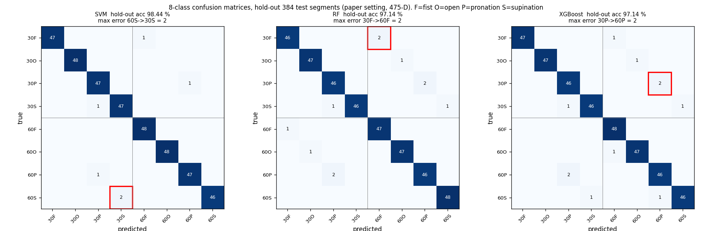
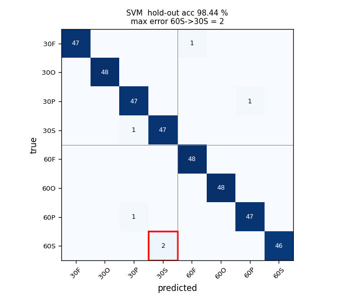
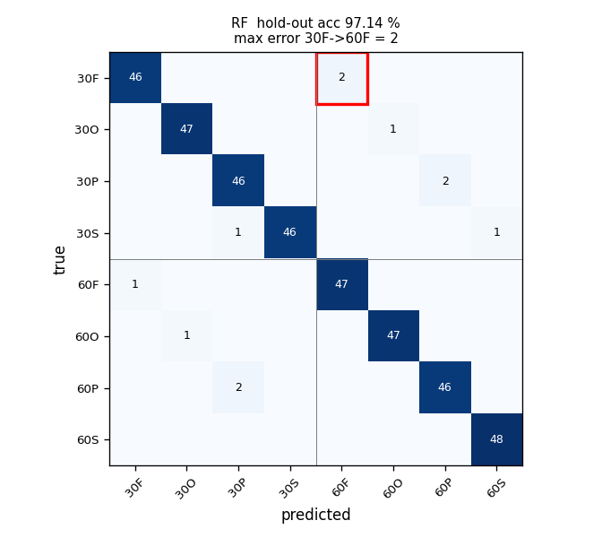
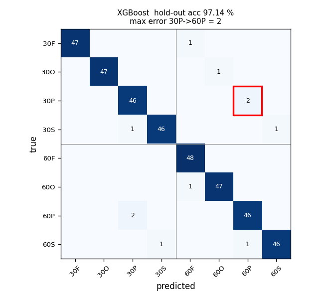
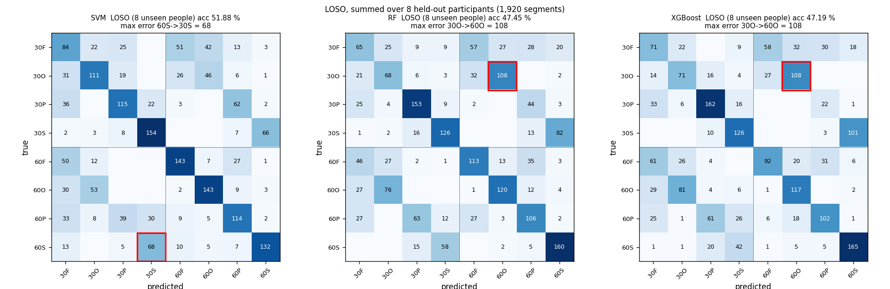

# sEMG 손동작·팔꿈치 각도 동시 분류 — AI 모델 재현 및 성능 비교

Lee, Kim & Choi (2026), *Simultaneous classification of hand gestures and elbow angles using sEMG signals: a comparison of machine learning performances* (Biomedical Engineering Letters)의 1인 재현 과제 (Step 2).
전완 3채널 + 상완 2채널 sEMG로 **손동작 4종(주먹·펴기·회내·회외) × 팔꿈치 각도 2종(30°·60°) = 8클래스**를 SVM · Random Forest · XGBoost로 분류하고 비교한다.

## 결과 한눈에 보기

| 평가 | SVM | RF | XGBoost | 논문 (RF / SVM / XGBoost) |
|---|---:|---:|---:|---|
| Hold-out 정확도 (384 세그먼트) | **98.44 %** | 97.14 % | 97.14 % | 96.88 / 96.35 / 95.57 % |
| 5-fold 정확도 (평균 ± 표준편차) | **97.60 ± 0.45** | 96.72 ± 0.31 | 96.61 ± 0.29 | 96.72 ± 0.58 / 95.83 ± 0.79 / 96.15 ± 0.56 |
| **LOSO 정확도 (처음 보는 사람)** | **51.88 %** | 47.45 % | 47.19 % | 보고 없음 (후속 과제로 제시) |
| 학습 시간 | 0.17 s | 0.31 s | 18.19 s | 0.334 / 0.313 / 19.846 s |

- **논문 수치를 재현했다.** RF 5-fold 96.72 %가 소수점 둘째 자리까지 같고, 학습 시간·모델 크기·추론 시간도 논문 Table 5와 거의 같다. 재현의 열쇠는 논문이 밝히지 않은 **표본 구성**이었다. 한 세그먼트의 19개 윈도우 특징을 **475차원으로 이어 붙여 표본 하나**로 쓰면 논문과 일치한다(2.3절).
- **하지만 이 97 %는 "같은 사람의 다른 시행"에 대한 성능이다.** 같은 모델을 처음 보는 사람에게 쓰면(LOSO) 47~52 %로 떨어진다. 2주차에 손을 쉬는 구간만으로도 동작을 87 % 맞힌 것과 같은 원인, 즉 녹음 세션과 개인차를 함께 외운 결과다(3.4절).

---

## 1. 코드 설명

### 사용한 데이터 및 전처리 방법

| 항목 | 내용 |
|---|---|
| 데이터 | 논문 저자 공개 [TestUser-alt-dev/sEMG-Hand-Gesture-Elbow-Angle-Dataset](https://github.com/TestUser-alt-dev/sEMG-Hand-Gesture-Elbow-Angle-Dataset). 64개 CSV = 피험자 8명 × 각도 2 × 동작 4, 파일 하나가 30시행 연속 녹음(1 kHz, 5채널) |
| 시행 추출 | `mark` 열(파일당 30개, 간격 5.0 s)부터 5,000샘플 → **1,920시행** (클래스당 240, 피험자당 30으로 완전 균등) |
| 필터 | 60 Hz 노치(Q 30) + 20~450 Hz 4차 Butterworth, `filtfilt` (영위상) |
| 세그먼트 | mark + **1.0~3.0 s** (2,000샘플). 논문은 시작점을 밝히지 않아, 1주차에 1,920시행 RMS 포락선으로 측정한 활성 구간(0.72~3.22 s)으로 정한 재현 가정 |
| 윈도우 | 200 ms, 증분 100 ms(50 % 오버랩) → 세그먼트당 19개 |
| 특징 | 윈도우·채널마다 RMS · MAV · WL · ZC(임계값 0.01) · SSC → 윈도우당 **25차원** |
| 표본 구성 | **논문 재현 설정**: 세그먼트 하나 = 19 × 25 = **475차원** 벡터 하나. **강의 실습 설정**: 윈도우 하나 = 25차원 표본 하나(비교용) |
| 표준화 | `StandardScaler`를 **학습 데이터에만 fit**, 평가 데이터는 transform만 (폴드마다 다시 fit) |

### 사용한 AI/ML 모델

논문 설정 그대로 (`src/models.py`).

| 모델 | 설정 |
|---|---|
| SVM | `SVC(kernel='rbf', C=1.0, gamma='scale', decision_function_shape='ovr')` — 기본값 |
| Random Forest | `RandomForestClassifier(n_estimators=100, random_state=42, n_jobs=-1)` — 기본값 |
| XGBoost | `XGBClassifier(objective='multi:softprob', n_estimators=400, max_depth=6, learning_rate=0.05, subsample=0.9, colsample_bytree=0.8, reg_lambda=1.0, tree_method='hist', random_state=42)` — 논문에서 유일하게 예비 튜닝된 설정 |

### 학습 및 테스트 방법

모든 분할은 **시행(세그먼트) 단위**다. 한 시행의 윈도우는 절반씩 겹치므로, 윈도우를 먼저 만들고 나누면 이웃 윈도우가 학습·평가 양쪽에 들어가 정확도가 부풀려진다(2주차 측정: +3.9 %p).

| 검증 | 방법 | 용도 |
|---|---|---|
| Hold-out | 2주차와 같은 분할: 클래스 × 피험자 층화 8:2, seed 42 → 학습 1,536 / 테스트 384 세그먼트. 테스트는 한 번만 평가 | 4지표, 혼동행렬, 계산 비용 |
| 5-fold | 1,920 세그먼트를 `StratifiedKFold(5, shuffle=True, random_state=42)` | 평균 ± 표준편차, 대응표본 t-검정 |
| **LOSO** | 피험자 1명을 통째로 빼고 7명으로 학습, 8번 반복 | 새 사람에 대한 성능. 녹음 세션 교란 제거 |

지표는 정확도와 클래스별 정밀도·재현율·F1의 **macro 평균**이다(논문은 평균 방식을 밝히지 않음). 클래스가 균등하므로 정확도와 macro 재현율은 같다.

### 실행 방법

```bash
bash setup.sh && source .venv/bin/activate   # 가상환경 + 패키지 + 데이터 clone (data/raw/, 1.2 GB)
python main.py all                            # 1~3주차 전체 (CPU 8코어 기준 약 25분, GPU 불필요)
python main.py week3                          # 3주차만: 학습·평가 → 표본 구성 실험 → 표·그림 (약 15분)
```

3주차 단계만 따로 돌릴 수도 있다: `python src/week3_run.py {holdout|cv|loso|concat}`, `python src/week3_analyze.py`.

### 코드 설명

| 파일 | 설명 |
|---|---|
| `main.py` | 전체 실험 실행 (`env`, `week1`, `week2`, `week3`, `all`) |
| `src/common.py` | 데이터 읽기: 파일 이름 해석(`extor` = 회외), `mark` 기준 시행 추출, 캐시, SHA-256 |
| `src/features.py` | 전처리와 특징: `preprocess`(노치 + 대역통과), `cut`(1.0~3.0 s), `make_windows`(200/100 ms), `td_features`(25차원) |
| `src/models.py` | 세 모델 구성(논문 설정)과 판정 점수 함수 |
| `src/week3_run.py` | 학습·평가: hold-out(+ 계산 비용), 5-fold, LOSO를 두 표본 구성(475D, 윈도우)으로 실행 → `results/week3/*.json` |
| `src/week3_sample_unit.py` | 표본 구성 비교 실험(475D 연결 / 윈도우 평균 25D / 윈도우 단위) |
| `src/week3_analyze.py` | 성능 평가 집계: 비교표, 대응표본 t-검정, 혼동행렬 그림, 오분류 유형, 피험자별 정확도 |
| `src/week1_*.py`, `src/week2_*.py` | 1주차(데이터 이해)·2주차(전처리·데이터셋·설정 검증) — 부록 참고 |
| `results/week3/` | 모든 수치의 원본(JSON)과 표(CSV)·그림(PNG) |
| `data/dataset.npz` | 2주차 데이터셋(윈도우 25차원, 표준화 완료, 시행 번호 포함) |

---

## 2. 모델 성능 비교

### 2.1 Hold-out (테스트 384 세그먼트, 논문 재현 설정 475D)

| Model | Accuracy | Precision | Recall | F1-score |
|---|---:|---:|---:|---:|
| **SVM** | **98.44 %** | **98.46 %** | **98.44 %** | **98.44 %** |
| Random Forest | 97.14 % | 97.16 % | 97.14 % | 97.14 % |
| XGBoost | 97.14 % | 97.18 % | 97.14 % | 97.14 % |

### 2.2 5-fold 교차검증과 통계 검정

| Model | fold 1 | fold 2 | fold 3 | fold 4 | fold 5 | 평균 ± 표준편차 |
|---|---:|---:|---:|---:|---:|---:|
| SVM | 97.66 | 97.14 | 98.44 | 97.40 | 97.40 | **97.60 ± 0.45** |
| Random Forest | 96.35 | 96.88 | 97.14 | 96.35 | 96.88 | 96.72 ± 0.31 |
| XGBoost | 96.61 | 97.14 | 96.35 | 96.35 | 96.61 | 96.61 ± 0.29 |

폴드별 정확도의 대응표본 t-검정 (α = 0.05):

| 비교 | 평균 차이 | p (5-fold) | 판정 | p (LOSO 8명) | 판정 |
|---|---:|---:|---|---:|---|
| SVM vs RF | +0.89 %p | 0.014 | 유의함 | 0.280 | 유의하지 않음 |
| SVM vs XGBoost | +0.99 %p | 0.041 | 유의함 | 0.208 | 유의하지 않음 |
| RF vs XGBoost | +0.10 %p | 0.621 | 유의하지 않음 | 0.897 | 유의하지 않음 |

### 2.3 표본 구성에 따른 차이 — 논문을 재현한 열쇠

같은 25차원 윈도우 특징을 모델에 어떻게 넣느냐만 바꾼 5-fold 정확도 (`results/week3/table_cv.csv`, `sample_unit_cv.csv`):

| 표본 구성 | SVM | RF | XGBoost |
|---|---:|---:|---:|
| **세그먼트 = 19 × 25 = 475차원 연결 (논문 재현)** | **97.60** | **96.72** | **96.61** |
| 세그먼트 = 19윈도우 특징 평균 25차원 | 89.58 | 90.83 | 92.03 |
| 윈도우 25차원 학습 → 19윈도우 점수 평균으로 판정 | 84.64 | 96.93 | 96.82 |
| 윈도우 25차원 학습 → 윈도우 하나로 판정 (강의 실습 dataset.npz) | 48.30 | 60.54 | 59.22 |

논문은 "세그먼트마다 25차원 벡터 19개를 만든다"고만 썼고, 테스트 표본 수(384)는 세그먼트 수와 같다. 475차원 연결이 RF 정확도(96.72 %)와 학습 시간(0.31 s vs 논문 0.313 s, XGBoost 18.2 s vs 19.8 s)을 함께 맞추므로 논문은 이 구성을 쓴 것으로 판단했다. 윈도우 하나(200 ms)로는 8클래스를 48~61 %밖에 못 맞힌다.

### 2.4 계산 비용 (hold-out 학습 1,536 세그먼트, 로컬 CPU 8코어)

| Model | 학습 시간 | 샘플당 추론 (일괄) | 샘플당 추론 (1개씩, 1스레드) | 모델 크기 | 논문 (학습 / 추론 / 크기) |
|---|---:|---:|---:|---:|---|
| SVM | 0.171 s | 0.283 ms | 0.464 ms | 4.40 MB | 0.334 s / 0.382 ms / 4.36 MB |
| Random Forest | 0.305 s | 0.018 ms | 3.839 ms | 4.38 MB | 0.313 s / 0.036 ms / 4.31 MB |
| XGBoost | 18.189 s | 0.029 ms | 0.872 ms | 3.72 MB | 19.846 s / 0.031 ms / 3.59 MB |

논문의 추론 시간은 일괄 예측을 샘플 수로 나눈 값과 맞는다. 실제 장치처럼 세그먼트를 하나씩 판정하면 RF는 트리 100개를 순회하는 고정 비용 때문에 3.8 ms로 오히려 가장 느리다.

### 성능 분석

**SVM이 hold-out(98.44 %)과 5-fold(97.60 ± 0.45 %) 모두에서 가장 높았고, 5-fold 대응표본 t-검정에서 RF·XGBoost보다 유의하게 앞섰다(p = 0.014, 0.041).** 475차원 표준화 특징 공간에서는 같은 클래스의 세그먼트가 촘촘히 모여 있어, RBF 커널의 거리 기반 경계가 축에 평행한 분할만 하는 트리 모델보다 유리했던 것으로 보인다. 학습도 0.17 s로 가장 빠르다. 다만 차이는 1 %p 안쪽이고, 처음 보는 사람으로 평가하면(LOSO) 세 모델의 차이는 유의하지 않다(p ≥ 0.21). 이는 논문 결론("RF가 1위지만 차이는 유의하지 않음")과 다르다. 논문 순위(RF > XGBoost > SVM)와 우리 순위(SVM > RF ≈ XGBoost)가 다른 것은 분할 시드, 세그먼트 시작점(재현 가정), 표준화 범위 같은 논문 미기재 조건에 따라 1 %p 안팎이 쉽게 흔들리기 때문이며, **"1위"보다 "세 모델 모두 같은 사람 안에서는 97 % 내외, 새 사람에게는 50 % 내외"가 이 실험의 주된 결과**다.

---

## 3. Confusion Matrix 분석

행 = 실제, 열 = 예측, hold-out 테스트 384 세그먼트(클래스당 48개). 표기: 30F = 30°·주먹, O = 펴기, P = 회내, S = 회외. 빨간 테두리가 최대 오류. 회색 선은 30° / 60° 경계다.



오분류를 유형별로 나누면 다음과 같다 (`results/week3/error_types.csv`):

| 모델 | 전체 오류 | 같은 동작·다른 각도 | 다른 동작·같은 각도 | 둘 다 다름 |
|---|---:|---:|---:|---:|
| SVM | 6 | **5** | 1 | 0 |
| RF | 11 | **10** | 1 | 0 |
| XGBoost | 11 | **8** | 3 | 0 |

### Model 1 — SVM



- **가장 잘 분류된 클래스**: 30_open, 60_fist, 60_open — 48/48 (재현율 100 %)
- **가장 많이 오분류된 클래스**: 60_supination — 재현율 95.8 % (46/48)
- **주요 오분류 유형**: 60_supination → 30_supination 2건. 전체 오류 6건 중 5건이 같은 동작의 각도 혼동
- **오분류가 발생한 이유**: 손동작은 전완 3채널(ECR·ED·FDS)의 진폭 비율로 크게 갈리지만, 각도는 상완이두근(BB)의 진폭 차이에 기대는데 그 차이가 작다. 1주차에 측정한 30° → 60° BB 증가는 회외 +55 %로 가장 크지만 피험자 8명 중 1명은 반대 방향이었고, 회외는 이두근이 동작 자체에 관여해 동작 세기에 따라 BB 진폭이 시행마다 크게 흔들린다. 그래서 진폭이 약하게 나온 60° 회외 시행이 30°로 넘어간다.

### Model 2 — Random Forest



- **가장 잘 분류된 클래스**: 60_supination — 48/48 (재현율 100 %)
- **가장 많이 오분류된 클래스**: 30_fist, 30_pronation, 30_supination, 60_pronation — 재현율 95.8 %. F1은 30_pronation이 94.8 %로 가장 낮다
- **주요 오분류 유형**: 30_fist → 60_fist 2건, 30_pronation → 60_pronation 2건, 60_pronation → 30_pronation 2건. 오류 11건 중 10건이 같은 동작의 각도 혼동
- **오분류가 발생한 이유**: 회내와 주먹은 1주차 분석에서 30°/60° 사이 BB 진폭 차이가 유의하지 않았던 동작이다(주먹 +7 %, p = 0.62; 회내 +12 %, p = 0.21). 각도 단서가 약한 동작에서 혼동이 몰리며, 논문의 최대 오류(60° 회내 → 30° 회내 6건)와 같은 패턴이다. RF는 475개 특징 중 무작위 일부로 분할하므로, 각도 정보를 담은 소수의 상완 특징을 덜 쓰게 되는 것도 원인일 수 있다.

### Model 3 — XGBoost



- **가장 잘 분류된 클래스**: 60_fist — 48/48 (재현율 100 %)
- **가장 많이 오분류된 클래스**: 30_pronation, 30_supination, 60_pronation, 60_supination — 재현율 95.8 %
- **주요 오분류 유형**: 30_pronation → 60_pronation 2건, 60_pronation → 30_pronation 2건. 오류 11건 중 8건이 각도 혼동이고, 나머지 3건은 동작 혼동(30_supination → 30_pronation, 60_supination → 60_pronation, 60_open → 60_fist)
- **오분류가 발생한 이유**: 각도 혼동은 RF와 같은 원인이다. 동작 혼동 3건 중 2건이 회외 → 회내인데, 두 동작은 전완을 비트는 방향만 다르고 손가락 근육(ED·FDS) 활성이 작고 비슷해서(1주차 표준편차 0.012~0.024 mV) 세기가 약한 시행에서는 회전 방향을 가를 단서가 부족하다.

### 처음 보는 사람에게는 어떻게 틀리는가 — LOSO 혼동행렬



| 모델 | LOSO 정확도 | 손동작만 맞힌 비율 | 각도만 맞힌 비율 | 가장 큰 오류 |
|---|---:|---:|---:|---|
| SVM | 51.88 % | 74.5 % | 65.2 % | 60S → 30S 68건, 30S → 60S 66건 |
| RF | 47.45 % | 75.3 % | 59.8 % | 30O → 60O 108건, 30S → 60S 82건 |
| XGBoost | 47.19 % | 75.0 % | 59.0 % | 30O → 60O 108건, 30S → 60S 101건 |

새 사람에게는 **각도(2지선다)가 59~65 %로 거의 우연 수준(50 %)**이고 손동작(4지선다, 우연 25 %)도 75 %로 떨어진다. 각도 단서인 BB 진폭은 사람마다 기본 크기와 증가 방향이 달라서(1주차: 주먹 BB는 8명 중 4명만 60°에서 증가), 다른 사람에게서 배운 "BB가 크면 60°" 규칙이 통하지 않는다. 피험자별로도 30.0 %(d, RF)에서 67.1 %(a·e, SVM)까지 편차가 크다(`results/week3/table_loso.csv`).

---

## 4. 최종 결과

- **가장 성능이 좋은 모델**: **SVM** — hold-out 98.44 %, 5-fold 97.60 ± 0.45 %, LOSO 51.88 %로 세 평가 모두 1위. 학습도 0.17 s로 가장 빠르다. 단 LOSO에서는 다른 두 모델과의 차이가 유의하지 않다.
- **가장 성능이 낮은 모델**: **XGBoost** — 5-fold 96.61 ± 0.29 %, LOSO 47.19 %. 유일하게 예비 튜닝을 거쳤지만 정확도 이득이 없었고 학습 시간은 18.2 s로 다른 모델의 60~100배다(RF와의 차이는 유의하지 않음, p = 0.62).
- **주요 오분류 클래스**: **같은 동작의 30° ↔ 60° 혼동**, 특히 회내(30P ↔ 60P)와 회외(30S ↔ 60S). hold-out 오류 28건 중 23건(82 %)이 각도 혼동이다. 새 사람에게는 펴기의 각도 혼동(30O → 60O 108건)이 가장 크다.
- **전체적인 실험 결과 및 느낀 점**
  1. **논문이 쓰지 않은 한 줄이 결과를 50 %p 바꿨다.** 같은 특징을 윈도우 단위로 넣으면 48~61 %, 세그먼트 475차원으로 넣으면 97 %다. "세그먼트마다 25차원 벡터 19개"라는 문장만으로는 어느 쪽인지 알 수 없었고, 정확도·학습 시간·모델 크기를 함께 맞춰 보고서야 논문 설정을 확정할 수 있었다. 재현 정보는 결과표만큼 중요하다.
  2. **97 %는 "같은 사람·같은 녹음 세션" 안에서의 성능이다.** 데이터가 클래스 × 피험자마다 별도 파일로 녹음되어, 시행 단위로 무작위 분할하면 같은 파일의 시행이 학습·평가에 함께 들어간다. 2주차에 손을 쉬는 4~5 s 구간만으로 손동작을 87.4 % 맞혔고, 3주차 LOSO에서는 정확도가 47~52 %로 반 토막 났다. 강의 마지막 문장 "96 %를 처음 보는 사람에게도 작동한다는 근거로 쓰면 안 된다"를 숫자로 확인했다.
  3. **모델 선택보다 검증 설계가 결론을 좌우한다.** 5-fold에서는 SVM이 유의하게 1위였지만 LOSO에서는 세 모델이 구별되지 않았다. 실제 의수·재활 기기에 쓰려면 모델을 바꾸기보다 사용자별 보정(짧은 캘리브레이션 데이터로 미세 조정), 피험자 간 정규화, 각도 축에 민감한 주파수 특징(MNF·MDF) 추가가 먼저다.

### 한계

1. **피험자 8명, 단일 세션.** 같은 날 한 번 부착한 전극으로 30회씩 연속 녹음했으므로 전극 재부착·날짜 간 변동은 측정되지 않았다. LOSO 결과가 보여 주듯 사람 간 차이가 크므로 8명으로는 일반화 성능을 안정적으로 추정할 수 없다(피험자별 30~67 %).
2. **trial-wise 분할과 녹음 세션 교란.** 논문 방식의 hold-out·5-fold는 같은 녹음 파일의 시행을 학습·평가에 나눠 쓰므로, 동작과 무관한 파일별 기저선 차이(파일 간 표준편차가 파일 내의 2.0~2.6배)까지 단서가 된다. 이 수치들은 데이터셋 내부 성능이며 새 사용자 성능이 아니다.
3. **재현 가정.** 세그먼트 시작점(1.0 s), 표준화 fit 범위, 지표 평균 방식(macro), 표본 구성(475D)은 논문에 없어 직접 정했다. 특히 시작점은 정확도가 아니라 생리적 활성 구간으로 정했는데, 정확도로 고르면 휴식 구간 쪽(녹음 세션 단서)이 선택되기 때문이다.
4. **정적 자세 2개 각도.** 30°·60° 두 점에서 자세를 고정한 데이터라 연속 각도나 움직이는 팔에는 그대로 적용할 수 없다.

---

## 부록 A. 1·2주차 요약

| 주차 | 내용 | 산출물 |
|---|---|---|
| 1주차 | 데이터 구조(파일 = 30시행 연속 녹음, `mark`로 분리), 동작 구간이 강의 가정(2~3 s)과 달리 0.72~3.22 s임을 측정, 30° vs 60° 비교(각도 단서는 이두근, 회외 +55 %), 클래스 설계안 | `report/Step2_1주차과제_보고서_*.pdf`, `docs/class_design.md`, `results/week1/` |
| 2주차 | 필터 → 세그먼트 → 윈도우 → 25차원 특징 → 시행 단위 분할 → 표준화 → `data/dataset.npz`. 학습셋 안 검증: 표본 단위(윈도우 59.5 % vs 세그먼트 95.8 %), 누수 크기(+3.9 %p), **휴식 구간만으로 손동작 87.4 %**(녹음 세션 교란) | `report/Step2_2주차과제_보고서_*.pdf`, `results/week2/` |
| 3주차 | 이 README | `results/week3/` |

## 부록 B. 환경

Ubuntu 22.04 (WSL2) · Python 3.10 · numpy 2.2.6 · scipy 1.15.3 · scikit-learn 1.7.2 · xgboost 3.2.0 · pandas · matplotlib. CPU 8코어, GPU 불필요. 모든 무작위성은 seed 42로 고정(5-fold `random_state=42`, 모델 `random_state=42`).
