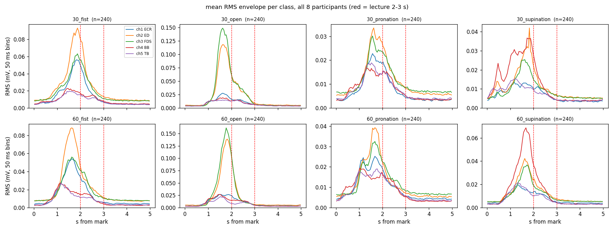
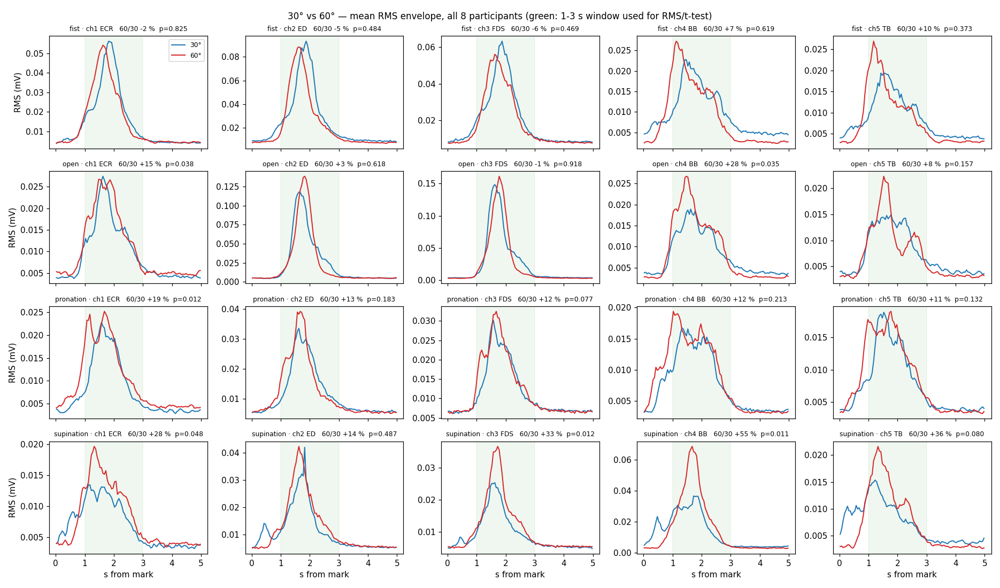
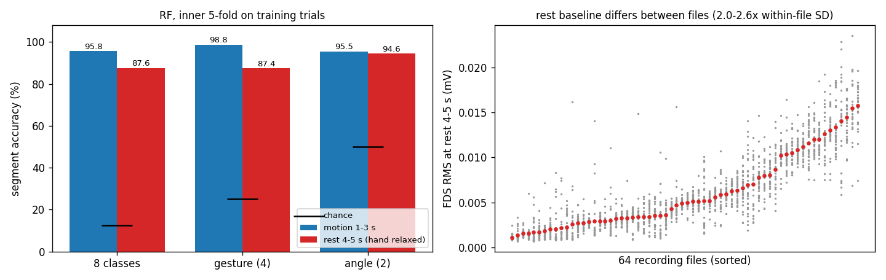

# semg-gesture-angle — Step 2 · sEMG 손동작·팔꿈치 각도 동시 분류

Lee, Kim & Choi (2026), *Simultaneous classification of hand gestures and elbow angles using sEMG signals: a comparison of machine learning performances* (Biomedical Engineering Letters, doi:10.1007/s13534-026-00607-7)의 1인 재현 과제.
전완 3채널 + 상완 2채널 sEMG로 **손동작 4종 × 팔꿈치 각도 2종 = 8클래스**를 SVM · Random Forest · XGBoost로 분류한다.
1주차(문제 정의·데이터 이해) → 2주차(전처리·25차원 특징) → 3주차(3모델 비교·교차검증·검정).

- 데이터: 논문 저자 공개 저장소 [TestUser-alt-dev/sEMG-Hand-Gesture-Elbow-Angle-Dataset](https://github.com/TestUser-alt-dev/sEMG-Hand-Gesture-Elbow-Angle-Dataset) (1.2 GB, `setup.sh`가 `data/raw/`에 clone). 파일 64개의 SHA-256은 `results/week1/file_summary.csv`에 기록해 두었다.
- Step 1(손바닥 sEMG 인증) 저장소: https://github.com/jjs523/semg-auth

## 빠른 시작

```bash
bash setup.sh && source .venv/bin/activate     # 가상환경 + 패키지 + 데이터 clone
python main.py week1                            # 1주차: 환경 확인 → 구조 집계 → 그림·각도 비교  (약 2분, GPU 불필요)
python build_week1_nb.py                        # notebooks/week1.ipynb 생성
python main.py week2                            # 2주차: 필터 → 세그먼트 → 윈도우 → 25차원 특징 → 시행 단위 분할 → data/dataset.npz + 설정 검증 (약 4분, CPU)
python report/build_week2_report.py --pdf       # 2주차 보고서 PDF
```

| 파일 | 역할 |
|---|---|
| `main.py` | 단일 진입점 (`env`, `week1`, `week2`) |
| `src/common.py` | 파일 이름 해석(`extor` = supination), mark 기준 시행 추출(5,000샘플), 캐시, SHA-256 |
| `src/week1_env.py` | 패키지 버전 → `results/week1/env.txt` (제출물 ①) |
| `src/week1_data.py` | 파일·클래스·채널 집계, 시행 1,920개 목록 → `file_summary.csv`, `class_summary.csv`, `trial_manifest.csv` (제출물 ②) |
| `src/week1_plot.py` | 5채널 파형, 클래스별 RMS 포락선, 활성 구간 측정, 30° vs 60° 비교와 대응표본 t-검정 (제출물 ③·④) |
| `src/features.py` | 2주차 공통: `preprocess`(60 Hz 노치 + 20~450 Hz), `cut`(mark+1.0~3.0 s), `make_windows`(200/100 ms), `td_features`(RMS·MAV·WL·ZC·SSC, 25차원) |
| `src/week2_features.py` | 2주차 단계 1~6 + 설정 검증(세그먼트 시작점·윈도우 길이·누수 크기) → `results/week2/`, `data/dataset.npz` |
| `src/week2_checks.py` | 표본 단위(윈도우 vs 세그먼트)와 녹음 세션 교란(휴식 구간으로 동작 맞히기) 검증 |
| `docs/class_design.md` | 클래스 설계안 5항목 (제출물 ⑤) |
| `notebooks/week1.ipynb` | 강의 5단계 순서의 노트북 (`week1_executed.ipynb`는 실행본) |
| `report/` | 보고서 생성기와 PDF |

## 1주차 — 문제 정의와 데이터 이해

### 데이터 구조 (직접 집계)

| 항목 | 값 |
|---|---|
| 파일 | 64개 = 피험자 8명(a~h) × 각도 2(30°, 60°) × 동작 4(fist, open, pro, extor=supination) |
| 파일 하나 | 30시행 연속 녹음 약 151 s, 열 8개(`bandpass 1~5`, `time`, `onset`, `mark`), 1 kHz |
| 시행 경계 | `mark`=1이 파일당 정확히 30개, 간격 4.999~5.001 s, 마지막 mark 뒤 여유 ≥ 5.7 s → mark부터 5,000샘플 |
| 시행 배열 | (1920, 5000, 5), NaN 없음, 클래스당 240시행(피험자당 30)으로 완전 균등 |
| 신호 | 이미 60 Hz 노치 + 20~450 Hz 필터 적용(저장소 README). 표준편차 0.027 mV, 절댓값 최대 8.0 mV |

### 동작 구간은 강의 가정과 다르다



강의 자료는 "휴식 2 s · 동작 1 s · 휴식 2 s"라서 동작이 mark 뒤 2~3 s에 있다고 가정하지만, 1,920시행의 RMS 포락선(시행별 기저선 + 3σ 임계값)으로 측정하면 활성은 **시작 0.72 s · 최대 1.68 s · 끝 3.22 s(중앙값)**이다. 8클래스 모두 같은 양상이다. 2주차의 2 s 분석 세그먼트는 **mark + 1.0 ~ 3.0 s**로 잡고 재현 가정으로 기록한다(`results/week1/motion_window.csv`).

### 같은 동작의 30° vs 60° (과제 ④)



활성 구간(1~3 s) RMS를 피험자별로 평균한 뒤 8명 대응표본 t-검정 (`results/week1/angle_rms_table.csv`):

| 동작 | 채널 | 30° (mV) | 60° (mV) | 60/30 | 8명 중 60°가 큰 수 | p |
|---|---|---:|---:|---:|---:|---:|
| supination | BB 이두근 | 0.0293 | 0.0454 | **+55 %** | 7 | 0.011 |
| supination | FDS | 0.0177 | 0.0236 | +33 % | 8 | 0.012 |
| open | BB 이두근 | 0.0157 | 0.0201 | **+28 %** | 7 | 0.035 |
| pronation | ECR | 0.0169 | 0.0202 | +19 % | 8 | 0.012 |
| fist | BB 이두근 | 0.0182 | 0.0194 | +7 % | 5 | 0.62 |

- **각도 단서는 상완이두근(BB)에 가장 크게 나타나고, 동작마다 크기가 다르다.** 회외·펴기는 BB가 뚜렷이 커지지만 주먹·회내는 진폭 차이가 유의하지 않다. 논문의 최대 오류가 60° 회내 → 30° 회내였던 것과 맞는다.
- **60°에서는 모든 동작의 활성이 0.1~0.2 s 일찍 시작한다**(`angle_compare.png`의 붉은 선이 왼쪽으로 치우침). 각도 정보가 진폭뿐 아니라 시간 구조에도 있다.
- 피험자별 그림(`angle_per_participant.png`)에서 회외 BB는 8명 중 7명이 같은 방향이지만 주먹 BB는 방향이 엇갈린다. 각도 축이 동작·피험자에 따라 불안정한 축이라는 뜻이고, 2주차 특징에 시간 정보를 보존해야 할 이유다.

### 클래스 설계안

[`docs/class_design.md`](docs/class_design.md) — ① 클래스 8개 정의 표, ② 채널·근육 대응과 데이터에서 본 역할, ③ 곱 구조 근거, ④ 독립 분류기 2개·계층적 분류와의 비교, ⑤ 각도 3·4종 확장 시 문제(클래스 폭발, 인접 각도 혼동, 동작별 단서 불균형, 연속 각도 문제로의 전환).

### 제출물 대조 (1주차 슬라이드 16쪽)

| 제출물 | 산출물 |
|---|---|
| ① 환경 확인 | `results/week1/env.txt`, 노트북 첫 셀 |
| ② 데이터 요약 | `results/week1/file_summary.csv`, `class_summary.csv`, `channel_stats.csv` |
| ③ 신호 그림 | `results/week1/ch5_example.png`, `envelope_by_class.png`, `envelope_all.png` |
| ④ 비교 관찰 | `results/week1/angle_compare.png`, `angle_rms_table.csv`, 위 서술 |
| ⑤ 클래스 설계안 | `docs/class_design.md` |
| 제출 형식 | `notebooks/week1.ipynb` + `report/` PDF + 이 저장소 |

## 2주차 — 전처리와 특징 추출

보고서: [`report/Step2_2주차과제_보고서_22114553_전진성.pdf`](report/Step2_2주차과제_보고서_22114553_전진성.pdf) · 노트북 `notebooks/week2.ipynb`

| 단계 | 처리 | 결과 |
|---|---|---|
| 1 필터 | `iirnotch(60, 30)` → 4차 Butterworth 20~450 Hz, `filtfilt(axis=0)` | 60 Hz 전력 20~24 %로, 15 Hz 미만·460 Hz 초과 약 1 %로, 전체 전력 90~95 % 보존 |
| 2 세그먼트 | mark + 1.0~3.0 s (1주차 활성 구간 측정 근거, 재현 가정) | (2000, 5) |
| 3 윈도우 | 200 ms, 증분 100 ms (50 % 오버랩) | (19, 200, 5) |
| 4 특징 | RMS·MAV·WL·ZC(th 0.01)·SSC × 5채널 | (25,) |
| 5 분할 | **시행 단위로 먼저** 8:2 (클래스 × 피험자 층화, seed 42) → 각 집합 안에서만 특징 | 학습 1,536시행 = 29,184윈도우 / 테스트 384시행 = 7,296윈도우 |
| 6 표준화 | `StandardScaler` 학습셋에만 fit | `data/dataset.npz` (Xtr, ytr, Xte, yte + 시행 번호·윈도우 위치·피험자) |

학습 1,536시행 안의 5-fold(RF 100트리)로만 확인한 것 — 테스트 384시행은 3주차까지 보지 않는다.

| 확인 | 결과 |
|---|---|
| 표본 단위 | 윈도우 1개 59.46 % / 세그먼트(19윈도우 확률 평균) **95.77 %** / 475차원 연결 95.70 % → 논문 96.72 %는 세그먼트 단위 |
| 누수 크기 | 시행 단위 59.46 % vs 윈도우 단위로 섞어 분할 63.40 % (+3.9 %p 부풀림) |
| 윈도우 길이 | 100 ms 52.1 % · 200 ms 59.5 % · 300 ms 63.5 % · 400 ms 67.0 % (길수록 오르지만 지연·표본 수 손해 → 200 ms 유지) |
| **녹음 세션 교란** | 손을 쉬는 4~5 s 구간만으로 손동작 4종을 **87.4 %** 맞힘(우연 25 %). 클래스 × 피험자마다 별도 파일로 녹음되어 휴식 기저선이 파일마다 2.0~2.6배 다름 → trial-wise 정확도에 녹음 세션 단서가 섞임. 3주차에 LOSO로 분리 |



## 환경

Ubuntu 22.04 · Python 3.12.13 · numpy 2.2.5 · scipy 1.16.3 · scikit-learn 1.7.2 · pandas 2.3.2 · matplotlib 3.10.5 · xgboost 3.4.1. 1·2주차는 GPU를 쓰지 않는다(2주차는 로컬 WSL, 8코어에서 약 4분).
